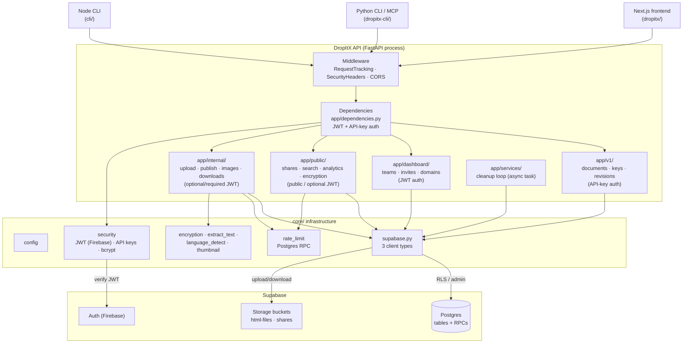

<!-- generated-by: gsd-doc-writer -->
# DropItX API — Architecture

## System overview

DropItX API is a FastAPI backend (Python ≥ 3.12, app version `0.3.0`) that powers a file-and-text sharing product with team collaboration. It is a thin, stateless service layer over **Supabase**: the Postgres database and object storage all live in Supabase, while authentication uses Firebase ID tokens verified against Google's public certs, and this API enforces business rules, composes upload/download flows, and exposes a clean REST surface.

Primary inputs are HTTP requests from three consumers — the Next.js web frontend (`dropitx/`), the Python CLI + MCP server (`dropitx-cli/`), and a bundled Node.js CLI (`cli/`). Primary outputs are JSON share metadata, streamed file content, and team-management responses. The service authenticates via two mechanisms (Firebase ID tokens and prefixed API keys), writes content to two Supabase Storage buckets (`html-files`, `shares`), and delegates persistence and atomic counters to Postgres RPC functions. It is architected in a **layered, router-aggregated style**: a single `FastAPI` app mounts four versioned/scope routers, each route handler depends on injected auth dependencies and calls into shared `core/` infrastructure.

The process is stateless and horizontally scalable; it is deployed to Render via `render.yaml` and started with `uvicorn app.main:app`. A single async background task runs a periodic cleanup loop for expired content.

## Component diagram



## Data flow

A representative write flow — **publishing editor content** (`POST /api/publish`, `app/internal/publish.py`):

1. Request enters `RequestTrackingMiddleware` (mints/reuses a request ID, sets context var) then `SecurityHeadersMiddleware`; CORS is applied last-added/first-executed.
2. The route's `user: User = Depends(get_current_user)` dependency extracts the `Authorization: Bearer …` token, calls `verify_firebase_jwt` (Google-certs-cached in `core/security.py`) via `asyncio.to_thread`, and returns a frozen `User(id, email)` dataclass — or raises `HTTPException(401)`.
3. Handler runs `check_upload_rate_limit(ip)` (10/min/IP, fail-open) against the Postgres RPC `check_rate_limit`, wrapped in `asyncio.to_thread`.
4. A slug + `delete_token` are generated via `core/nanoid.py`; content is uploaded to the `html-files` bucket through `get_admin_client().storage.from_("html-files").upload(...)`.
5. A row is inserted into the `shares` table. **If the insert fails after a successful upload, a compensating transaction removes the orphaned storage object** (`_cleanup_storage`).
6. Fire-and-forget tasks may be spawned (e.g. thumbnail generation via `core/thumbnail.py`).
7. The handler returns a `PublishResponse`; `RequestTrackingMiddleware` logs the structured request line and echoes `x-request-id` / `x-response-time`.

A representative read flow — **viewing a public share** (`GET /api/shares/{slug}/content`, `app/public/shares.py`):

1. No auth dependency; the handler calls `_fetch_share(slug)`, which returns `404` if missing, `410` if burned / one-time-download consumed / expired (expired shares are auto-deleted in-band).
2. If `password_hash` is set, the response short-circuits with `password_protected=true` and empty content; `POST /shares/{slug}/unlock` (rate-limited 5 per 10 min per IP+slug, fail-closed) verifies the bcrypt hash before returning content.
3. Otherwise the object is downloaded from the bucket selected by `source` (`html-files` for `upload`/`editor`, else `shares`), decoded, and returned.
4. View count is incremented via the `increment_view_count` RPC as a fire-and-forget task; burn-after-reading and one-time-download flags trigger best-effort deletion tasks.

Uncaught domain exceptions are translated by global handlers in `app/main.py`: `RateLimitError → 429`, `ShareNotFoundError → 404`, `SharePasswordRequired → 403`, and any other `Exception → 500`. Every error body uses the uniform `ErrorResponse(error, detail, request_id)` envelope from `core/exceptions.py`.

## Key abstractions

| Abstraction | Location | Purpose |
| --- | --- | --- |
| `Settings` | `core/config.py` | Pydantic-settings config loaded from `.env`; exposes `cors_origins` property. |
| `get_admin_client()` / `get_user_client(token)` / `get_anon_client()` | `core/supabase.py` | Three Supabase client flavors: service-role (bypasses RLS — used by most routes), per-request user JWT (RLS-enforced), and anon. |
| `verify_firebase_jwt(token)` | `core/security.py` | RS256 JWT verification against Google's cached x509 certs. |
| `generate_api_key` / `hash_api_key` | `core/security.py` | Generates `shk_` (personal) / `sht_` (team) keys; stores SHA-256 hashes, returns raw key once. |
| `User`, `ApiKeyAuth` | `app/dependencies.py` | Frozen auth dataclasses yielded by `get_current_user`, `get_optional_user`, `get_api_key`. |
| `check_*_rate_limit` | `core/rate_limit.py` | Thin wrappers over the `check_rate_limit` Postgres RPC; configurable fail-open / fail-closed. |
| `ErrorResponse`, `RateLimitError`, `ShareNotFoundError`, `SharePasswordRequired` | `core/exceptions.py` | Domain exceptions + the uniform error envelope consumed by `app/main.py` handlers. |
| `RequestTrackingMiddleware`, `SecurityHeadersMiddleware` | `core/middleware.py` | Per-request ID + structured logging + hardening headers (HSTS, nosniff, DENY framing, etc.). |
| `require_team_member(user_id, team_id, min_role)` | `app/dashboard/team_helpers.py` | Centralized role check against the `owner(3) > editor(2) > viewer(1)` hierarchy. |
| `ShareBase` / `ShareCreate` / `ShareResponse` | `models/share.py` | Pydantic DTOs mirroring the `shares` row and request/response payloads. |
| `run_cleanup_loop()` | `app/services/cleanup.py` | Async background task (5-min interval) deleting expired shares, trimming revisions (>50/share), and deactivating expired file requests. |

Cross-cutting convention: **every synchronous Supabase call is wrapped in `asyncio.to_thread(...)`** because the Python Supabase client is blocking. Routes are thin and push persistence logic into `core/` helpers and per-feature modules.

## Directory structure rationale

```
dropitx-api/
├── app/                    FastAPI application layer
│   ├── main.py             App factory: middleware, exception handlers, router mounts, startup task, /health
│   ├── dependencies.py     Auth providers (JWT, API key, optional), client-IP extraction
│   ├── v1/                 API-key-authenticated REST (/api/v1) — documents, keys, revisions
│   ├── dashboard/          JWT-authenticated team management (/api/dashboard) — teams, invites, domains
│   ├── public/             Public / optional-JWT endpoints (/api) — shares, search, analytics, encryption, explore
│   ├── internal/           Authenticated upload/publish/image/download flows (/api)
│   └── services/           Background workers (cleanup loop)
├── core/                   Cross-cutting infrastructure (no HTTP): config, supabase, security, rate_limit,
│                           middleware, exceptions, logging, encryption, text/language utils, nanoid, thumbnail
├── models/                 Pydantic DTOs for shares, teams, api_key, analytics, domain, file_request
├── migrations/             Per-feature SQL migration fragments (encryption cols, comments, revisions, domains…)
├── supabase/               Local Supabase project config + base SQL migrations (config.toml, base schema)
├── tests/                  pytest suite (asyncio_mode=auto) — endpoints, encryption, domains, file requests, preview
├── cli/                    Bundled Node.js CLI (npm package "dropitx-cli", bin `dropitx`) — shares files from terminal
└── docs/                   Project documentation
```

**Why this layout:** `app/` is split by **auth surface** rather than by domain — `v1/` (API-key), `dashboard/` (required JWT), `internal/` (upload/auth flows), `public/` (no/optional auth). Each subpackage owns an `APIRouter` and aggregates into `main.py`, keeping route registration centralized while letting each surface evolve independently. `core/` holds everything HTTP-agnostic so it can be unit-tested without spinning up the app. `models/` is a flat DTO package imported across surfaces. The two SQL directories differ in provenance: `migrations/` holds incremental per-feature scripts tracked alongside code, while `supabase/` carries the base schema and local-Dev config for the Supabase CLI. The Node `cli/` ships alongside the Python service because the terminal client consumes this API directly.

## Consumers and deployment context

The API is consumed by the `dropitx/` Next.js frontend (dashboard and editor flows via JWT), the `dropitx-cli/` Python CLI + MCP server (API-key document flows under `/api/v1`), and the bundled Node `cli/` (`cli/bin/dropitx.js`, published as the npm `dropitx-cli` package). It runs on Render (`render.yaml`: `python` runtime, `pip install -r requirements.txt` build, `uvicorn app.main:app --host 0.0.0.0 --port $PORT` start, Python 3.12.0). Liveness is exposed at `GET /health` and a DB-latency-aware deep probe at `GET /health/deep` (which pings the `shares` table through the admin client). <!-- VERIFY: production Render service URL and Supabase project URL are not present in the repo and must be sourced from Render/Supabase dashboards. -->
